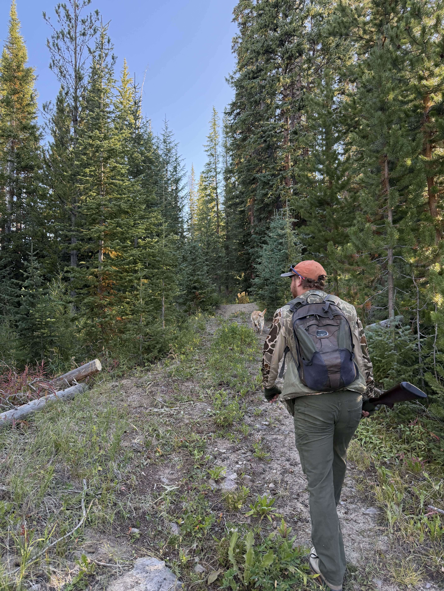
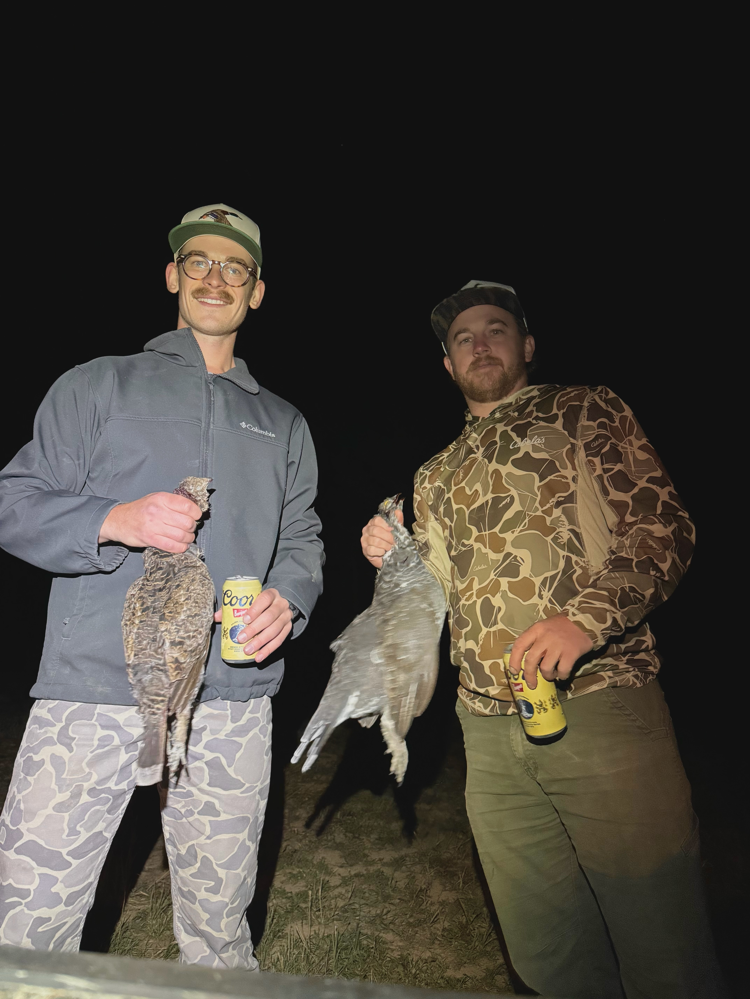
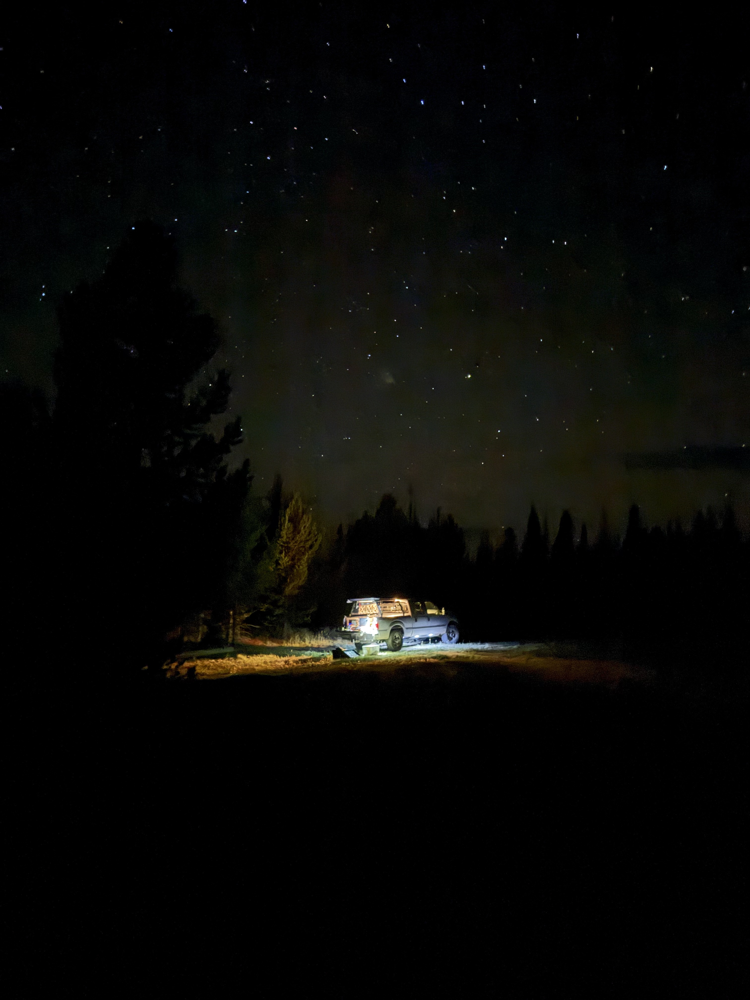
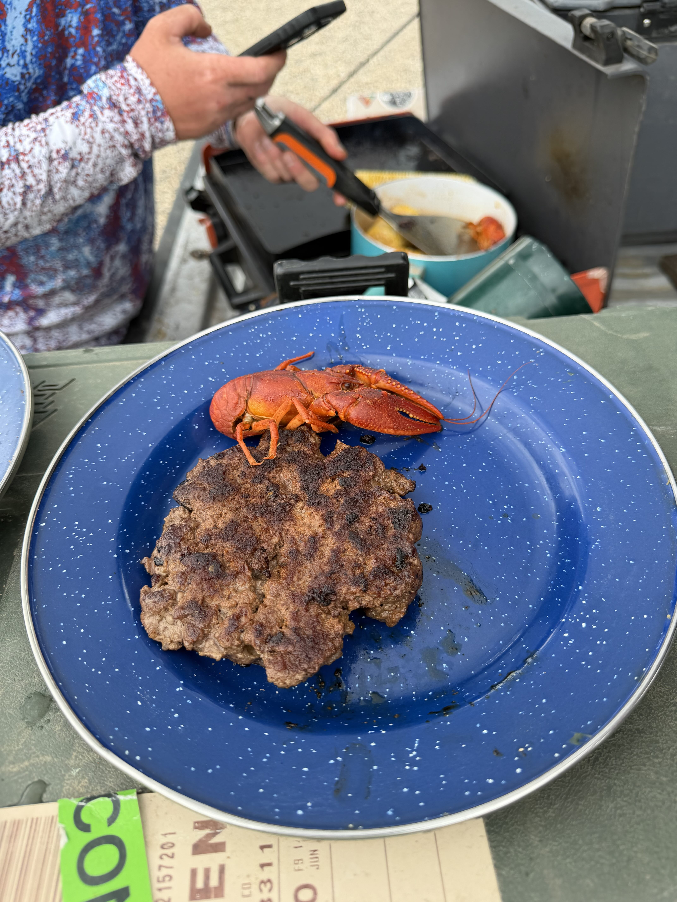
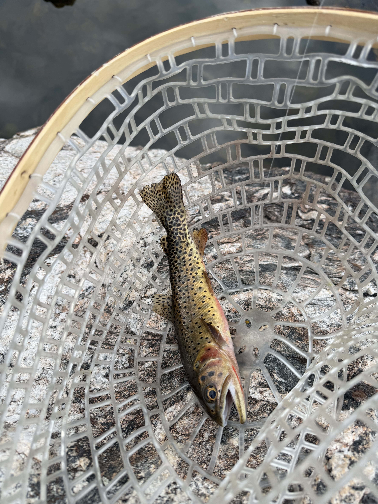

After finally wrapping up nearly 2 years of grad school, I was pretty excited to organize a trip to see my buddy Damian again in Denver (see my previous [Denver, CO](/2025-12-06-colorado-geese) trip). This time, it was opening weekend for [grouse](https://en.wikipedia.org/wiki/Grouse) in Colorado. Grouse could be described as basically the chickens of the mountains and plains, and make for a great hunting experience with or without dogs.

We set out the first day through the Arapaho National Forest, starting with a few waypoints that Damian's buddy had shared with him. There were a lot of elk camps setup by hunters nearby who were either glassing or scouting for elk at the time.

We didn't have much luck early in the day, since we hadn't quite realized that grouse are mostly active at dawn and dusk. They can also be pretty difficult to spot, often requiring you to look closely up in nearby trees or to flush them out of foliage. We spent a lot of the day wandering around the forest, trying a few different waypoints, before chatted to some elk hunters who told us about the activity they had seen around dusk the day before. Unsurprisingly, we were then fortunate enough to shoot 3 grouse that evening in the waning sunlight hours!

We setup camp two nights in Arapaho National Forest, within a 15-minute drive along the access roads to the different waypoints. It was incredibly quiet and clear, and we slept in the rooftop tent on Damian's truck. When packing for the trip, I wasn't fully aware we'd be camping these nights, but fortunately it didn't get too cold and I had a few extra layers with me. It did make for some awesome photos in contrast with the stars and darkness!

The next day and a half were spent fishing both alpine lakes and then the legendary Dream Stream (along the South Platte River). This was an awesome but frustrating time, both Damian and I had little success. I'll never forget the one that got away on the Dream Stream, I was on a rainbow trout at least 15" or more, but unfortunately he was able to jump off the line. It still made for a good time, and we even cooked up some fresh crawfish and elk meat for lunch.

When fishing the alpine lakes, I was fortunate enough to land a few smaller cutthroat trout! While it wasn't the most success I've had at a lake like this before, the trout were few and far between from what I could see. Despite all this, I was happy to at least land one, which was more than other fishermen around the lake were experiencing! Getting to see trout like these up close in their natural environment is a privilege.

We had a few difficulties navigating to the lake, and we actually didn't get to our intended lake since it was late in the day and we had lost the trail more than once. At least this time, I didn't have any adverse experiences with the altitude!

I really love Colorado and the experiences that come with it if you're willing to put yourself out in the wilderness. Combining that with the experience of hunting grouse for the first time made for another successful trip, and I'm looking forward to my annual Colorado adventure next year!
