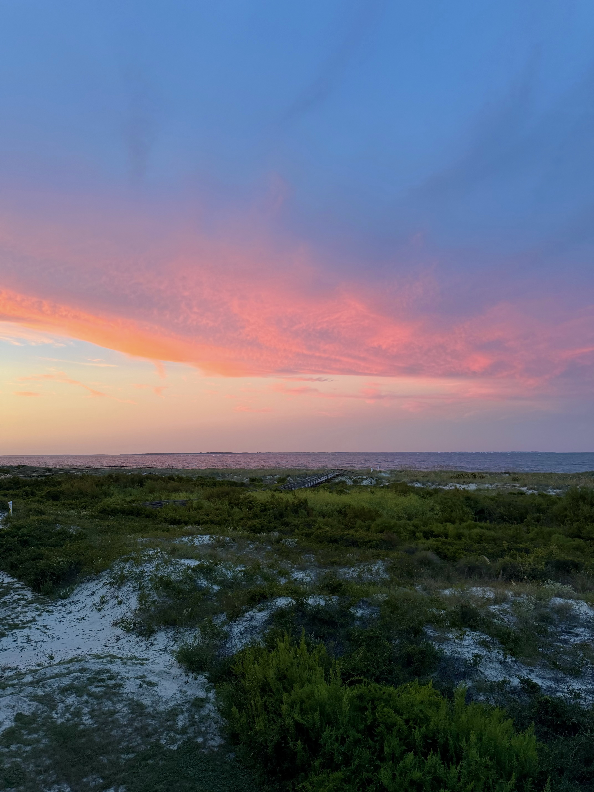
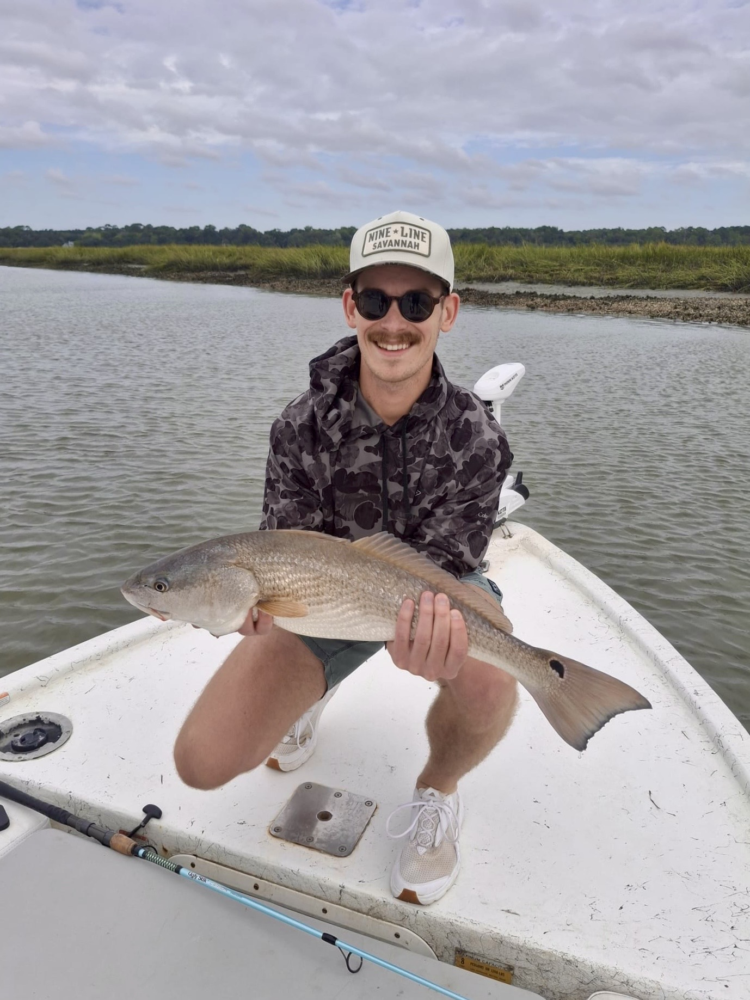
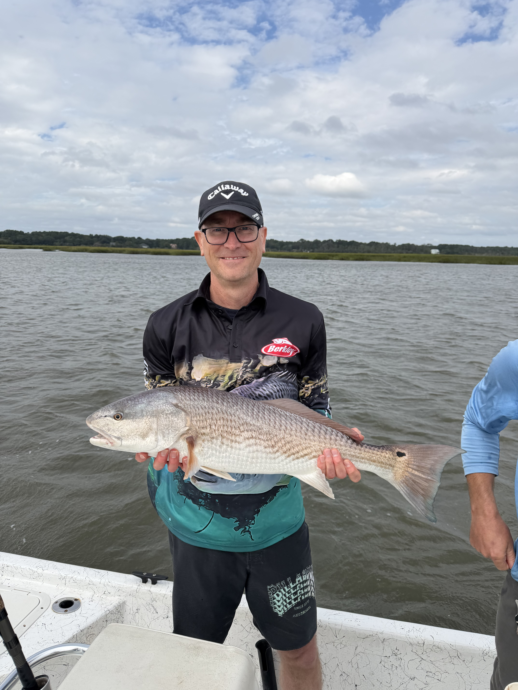

My parents came to visit in October 2026, and we had planned to have a few days in South Carolina, specifically on Harbor Island! I hadn't seen the ocean in years at this point, so it was a trip I was looking forward to. The weather was great while we were there, and we were staying right on the beach. This made for some nice sunsets!

One of the mornings we were there, dad and I had organized a half-day inshore fishing trip to try our luck at the fish in the area! We were out there with Nat from [Cast Away Charters](https://beaufortcastawaycharter.com/), and it was an awesome day of fishing. I started the day off strong, catching some smaller redfish (or [red drum](https://en.wikipedia.org/wiki/Red_drum)) before getting on a huge one mid-morning! This guy would've been about 20", and certainly represented a fishing record for me!

Soon after this, my fishing luck transferred to dad, and later in the morning he landed an even bigger redfish! We measured it on the boat to be nearly 24".

I really enjoyed this trip as it marked a few days to relax, see a new part of the US, and spend time with my family! I can't wait to go back and spend more time in Charleston, since we got just a glimpse for a few hours before our flight to St. Louis.
